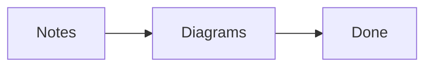

# Mermaid diagrams

[Feature-parity index](../FEATURE-PARITY.md)

**Claim completed:** Codex (Mermaid), 2026-10-21. Verified fenced-diagram subset
in the shared desktop/WASM Reading renderer, page previews and Slides.

## Using Mermaid

Write a fenced `mermaid` block in a Markdown note, then use **Ctrl+E** or the
pane's Reading button:

````markdown

````

There is no core-plugin toggle or new settings page. The same renderer is used
by enabled Page preview and Slides. The selection-aware Live Preview editor now
uses it for inactive top-level Mermaid fences too; its **Edit** control reveals
the original fence in CodeMirror. Source mode always retains ordinary editable
code. Diagrams reflect unsaved shared-buffer
edits without saving the note, and clean external changes refresh their images.
Switching modes retains editor undo/redo. Rendering never rewrites the note.

Each successful diagram has a scalable image and an expandable **Diagram source**
section. Syntax/unsupported-option errors appear beside the original source;
one failed diagram does not prevent later blocks from rendering. Accessible
image text uses the diagram's accessibility title/description or its SVG labels.

The real runtime scenarios exercise flowcharts, sequence/class/state diagrams,
entity relationships, Gantt, pie, mindmaps and Git graphs, plus a flowchart using
ELK and a different theme. Other diagram families in the bundled engine are not
individually accepted. Ordinary code and nested literal fences stay literal.

## Configuration and limits

The implementation bundles the official **Mermaid 12.2.0** npm renderer, pinned
in `package-lock.json`. The default is dark, classic styling with Dagre layout.
Supported per-diagram frontmatter fields are `title` (up to 300 characters) and
`config`, with these display options:

| Option | Accepted values |
|---|---|
| `theme` | `default`, `dark`, `neutral`, `forest`, `base` |
| `look` | `classic`, `handDrawn`, `neo` |
| `layout` | `dagre`, `elk` |

For example, place this inside a Mermaid fence:

```text
---
title: A different layout
config:
  theme: forest
  layout: elk
---
flowchart LR
  Start --> Finish
```

Legacy `%%{init: {...}}%%` / `initialize` directives accept the same display
options. Raw configuration is extracted and validated before rendering; custom
renderer settings, HTML labels, scripts, plugins, fonts and `themeCSS` are
refused explicitly. Ordinary Mermaid diagram syntax such as `classDef` remains
handled by Mermaid. The upstream [configuration/directive documentation](https://mermaid.js.org/config/directives.html)
describes a wider contract than this supported option subset.

Bounds are 32,768 source characters per block, 32 rendered diagrams per view,
64 queued jobs, 256 Mermaid edges and 4 MiB of SVG output per diagram. Images
must have finite positive dimensions, at most 20,000 units on either side and
100 million units of area. Excess blocks remain code with a visible limit
message. Fifteen-second load/render deadlines clean up missing or unfinished
asynchronous work; these are not a hard CPU-isolation guarantee for pathological
layout input.

## Isolation, assets and lifecycle

The engine loads on demand in one temporary iframe with `sandbox="allow-scripts"`
and an opaque origin. It refuses an environment exposing Node. Its CSP blocks
network connections, external fonts, workers and document features; the only
script is the local bundled renderer. A private MessageChannel carries bounded
requests/results. Requests are serialized so Mermaid's global configuration
does not leak between diagrams.

The host supplies strict security mode, disables HTML labels and does not bind
click callbacks. Mermaid documents strict mode's encoded HTML and disabled
click behavior in its [usage guide](https://mermaid.js.org/config/usage.html).
Generated SVG is additionally sanitized, dimension-checked and displayed as a
blob-backed image, rather than inserted into application DOM. The browser's
[SVG image restrictions](https://developer.mozilla.org/en-US/docs/Web/SVG/Guides/SVG_as_an_image)
also disable scripting and external resources in that image context. Raw note
SVG/HTML does not gain Mermaid privileges.

Superseded/cancelled requests cannot install late results. Switching modes,
closing views, advancing slides and dismissing previews release their images
and jobs. Idle/cancelled renderer frames are removed. Blob URLs are revoked
when their Reading view is cleared.

`mermaid-frame.html`, `js/mermaid-frame.js` and dependency license notices are
published locally on both hosts. The engine adds about 5.4 MB of minified,
uncompressed JavaScript to the installed static assets and is separate from the
normal editor bundle. No CDN, diagram server or note upload is required. Fonts
use local system fallbacks. The frame URL respects the application's base path.

## Evidence and remaining work

Five model/native tests cover source preservation, supported configuration,
unsafe overrides, malformed/cyclic/duplicate/oversized input and actual native
frame assets/CSP. The complete regression snapshot passed **157 tests**, with
zero failures or skips. Four shared actual UI/file groups passed on each host;
the browser additionally passes twelve storage/bootstrap groups using the OS
folder picker and actual directory handles without renderer Node.

```powershell
npm run build
npm run smoke:mermaid
npm run build:web -- --base=/ --no-restore
npm run smoke:mermaid:web
npm run verify:web -- --base=/
```

The scenarios inspect decoded images and actual SVG labels, exact BOM/CRLF/
Unicode files, dirty/undo/split/external updates, cancellation and URL cleanup,
individual errors and unsafe configuration, Slides/previews, full desktop
restart or browser reload/reconnect, and rendering with HTTPS/CDN requests
blocked. Reports are `.runtime/evidence/mermaid-smoke.json` and
`mermaid-web-smoke.json`; screenshots are `mermaid-desktop.png` / `mermaid-web.png`.
These are artifact-bound local snapshots, not reference-runtime comparison or
proof of a deployed website.

Root hosting and `/mermaid-check/` subdirectory hosting both passed browser
workflows and static serving checks. The subdirectory report is retained as
`mermaid-subpath-web-smoke.json`; the final local publication uses `/`.

The editing-mode scenarios additionally decode an actual local flowchart inside
CodeMirror on desktop and actual-folder WASM, reveal its original fence through
the real Edit button and require the old image URL to be revoked. This is a
bounded Live Preview fixture, not renewed ten-family acceptance in every editor
context. Its mode/source/undo/lifecycle evidence is recorded with the
[editor-mode subset](APPLICATION.md#editing-modes-and-ownership).

Remaining work includes broader Live Preview fixtures, public `loadMermaid`,
complete renderer/private contracts, interactive links/callbacks,
external image/icon/font packs, broader configuration/types/accessibility,
large/pathological graphs, complete native visual behavior and original-runtime
comparison. General Markdown math and arbitrary SVG embeds remain separate
features. Bounded public static Markdown/code-block APIs now have separate
[ownership and host evidence](../Compatibility/PLUGIN-API.md#static-markdown-and-code-block-ownership);
that does not establish Mermaid's full public API. The fixed core-plugin
benchmark totals are unchanged.
