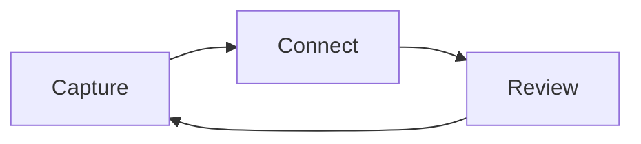

# Mermaid Tools

> [!info] Optional plugin
> Install and enable **Mermaid Tools** (`mermaid-tools`) for this exercise. Reference version: **1.4.3**. Minimum Obsidian: **1.4.0**. See [[00 Start/Install community plugins]].

Native Obsidian renders this diagram even without Mermaid Tools:

Enable Mermaid Tools, place the cursor in the diagram’s source, and open the plugin’s diagram toolbar or command. Add a node and connection.

**Expected:** the Markdown source changes and the diagram re-renders. The plugin assists editing; native Mermaid supplies rendering.

---
[[00 Start/Community tour|All community examples]] · [[Start here]]

[Upstream documentation](https://github.com/dartungar/obsidian-mermaid) · [Exact release](https://github.com/dartungar/obsidian-mermaid/releases/tag/1.4.3)
