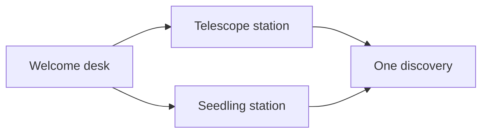
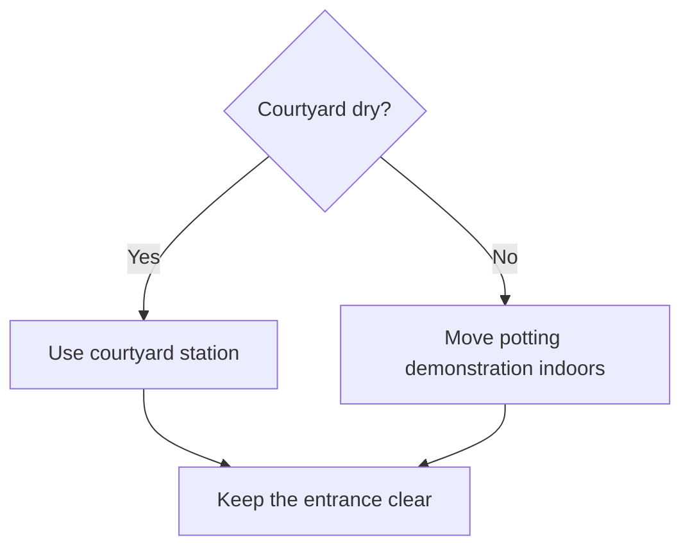
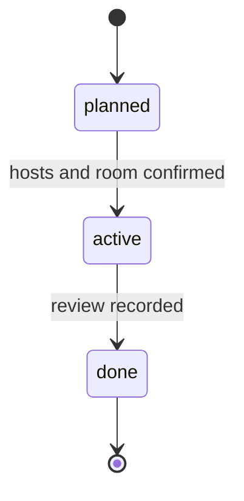
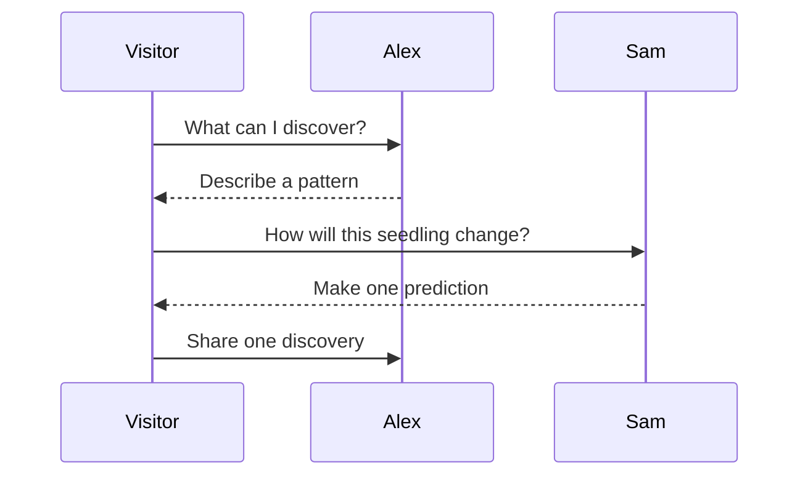
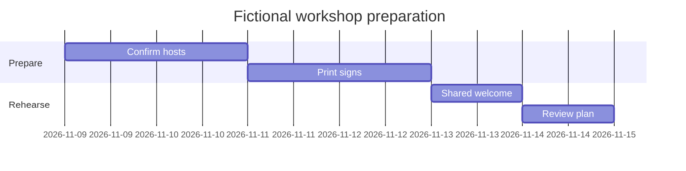

# Diagram workshop

Mermaid Tools includes a prepared **Workshop** toolbar category with three reusable flowchart fragments: the two-station route, a weather decision and the review loop. Built-in toolbar elements remain available. Open **Mermaid: Open Toolbar View**, choose Workshop and insert a fragment into a new fenced `mermaid` block.

## Exercise 1 · Reuse a meaningful fragment

In a new note, start a fenced Mermaid block with only `flowchart LR`, put the caret on its next line and insert the two-station fragment from the toolbar. This is the prepared result to compare with:

Change `LR` to `TD`, add one node using a built-in toolbar element, and inspect the actual Markdown inserted by the plugin. The toolbar inserts source; it does not assign tasks to hosts.

## Exercise 2 · Keep a decision visible

The weather fragment makes the indoor alternative explicit:

Edit a copy of this element through Mermaid Tools settings, change its description, and move it within the custom category. Reinsert it into a new note to see the saved element change. Existing diagrams keep their own text.

## Exercise 3 · Explain status separately from task completion

Compare the state diagram with the actual Project class's `planned`, `active` and `done` choices. Edit the diagram source or try a state element from the built-in toolbar. The drawing documents the rule; it does not change frontmatter.

## Exercise 4 · Show handover order and a fixed timeline

The sequence shows who speaks next; the Gantt chart shows a fixed preparation schedule. Add another exchange or change a task duration in a copy and compare the rendered result. Native Mermaid renders all five blocks; plugin toolbar insertion and element management are the additional features demonstrated here.

[[20 Community/Mermaid Tools]] · [[60 Visuals/Workshop workflow]] · [[80 Sandbox/Plugin lab/Plugin lab]]
