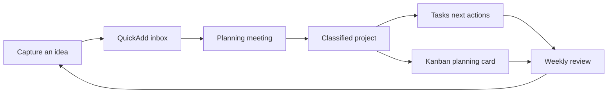
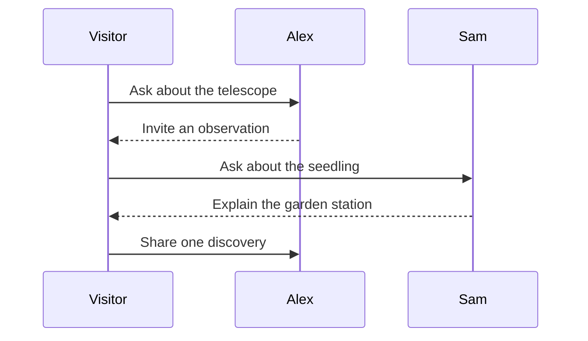

# Workshop workflow

Two diagrams for planning the sample evening. Mermaid Tools helps author the source; Mermaid rendering is built into Obsidian and Slopsidian.

## From capture to review

The arrows describe a human workflow. Moving a card or editing a class field does not perform all the other steps automatically.

## A visitor's evening

In a copy, use Mermaid Tools' flowchart commands to add a **Send invitation** node between the meeting and project steps. Edit the sequence text directly to add a second question. The plugin's authoring controls vary by diagram type; plain Mermaid source remains the portable result.

[[20 Community/Mermaid Tools]] · [[80 Sandbox/Workshop agenda]] · [[30 Projects/Project cockpit]]
