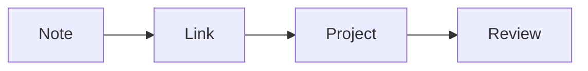

# Editing playground

A reusable place to try native editing and optional editor plugins.

## Basic formatting

**Bold**, *italic*, ~~strikethrough~~, `inline code`, ==native highlight== and a link to [[30 Projects/Observatory]] all work in stock Obsidian. #sandbox #demo/editing

> [!tip] Try all three modes
> Source, Live Preview and Reading view show the same note differently.

## Tables

| Item | Quantity | Notes |
| --- | ---: | --- |
| Telescope | 1 | Shared use |
| Seed packets | 8 | Mixed varieties |
| Notebooks | 12 | Field notes |

## Outline exercise

- Plan the visit
  - Check the weather
  - Pack a notebook
  - Invite a friend
- Review what happened
  - Write one observation
  - Link a related note

### Deep detail

This third-level heading appears below Outline exercise.

## Highlights

Make this sentence easy to find. Compare it with ==this native highlight==.

## Date capture

Add a date after this prompt:

## Completion exercise

Start a word here:

## Diagram

## Image and audio

![[90 Attachments/Vault map.svg]]

![[90 Attachments/Synthetic tone.wav]]

## Footnotes

A small source note can keep an explanation nearby.[^example]

[^example]: This footnote is an original sample explanation, not an external quotation.

[[Start here]]
